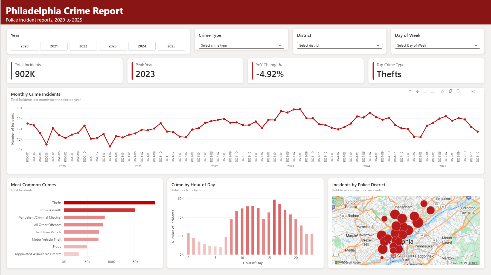

# Philadelphia Crime Analysis (2020 to 2025)

An end-to-end data analysis project using **900,000+ Philadelphia police incident reports**. I combined and cleaned the data in **MySQL**, checked my numbers, and built an interactive dashboard in **Power BI**.

---

## The Question

How has crime in Philadelphia changed since 2020, and what patterns show up by crime type, time of day, and police district?

## Data

- **Source:** [Philadelphia Police Department, Part 1 & Part 2 Crime Incidents](https://metadata.phila.gov/#home/datasetdetails/5543868920583086178c4f8e/representationdetails/570e7621c03327dc14f4b68d/) via OpenDataPhilly
- **Range:** January 2020 to December 2025
- **Size:** 901,837 incidents across six yearly files
- **Note:** This is *reported* incident data. It shows what was reported to police, not all crime, and counts may not match official FBI (UCR) statistics.

## Tools

| Tool | Used for |
|---|---|
| MySQL | Combining, cleaning, and analyzing the data |
| VS Code | Writing and running SQL |
| Power BI | Interactive dashboard |

## Process

1. **Combine:** Merged six yearly CSV files into one table with `UNION ALL`.
2. **Clean:**
   - Set coordinates that fell outside Philadelphia to `NULL` so they would not distort the map.
   - Found **102,175 records** (100,619 of them from 2023) with a missing `hour` value and rebuilt them from each incident's dispatch time.
   - Found that the `dispatch_date_time` field is stored in **UTC**, which pulled 55 late-night incidents from 12/31/2019 into the 2020 file. All analysis filters on the local `dispatch_date` instead.
3. **Validate:** Checked every number in the dashboard against SQL query results.
4. **Visualize:** Connected Power BI to MySQL through the MySQL connector using a read-only database user, then built the dashboard.

## Key Findings

| Year | Total Incidents | Car Thefts | Homicide Incidents | Gun Robberies | Gun Assaults |
|---|---|---|---|---|---|
| 2020 | 134,411 | 2,539 | 499 | 1,872 | 3,849 |
| 2021 | 134,368 | 7,487 | 545 | 2,418 | 3,715 |
| 2022 | 151,190 | 11,818 | 497 | 2,954 | 3,403 |
| 2023 | **169,002** | **22,478** | 385 | 2,587 | 3,320 |
| 2024 | 160,381 | 14,677 | 260 | 1,690 | 2,811 |
| 2025 | 152,485 | 14,589 | 215 | 1,256 | 2,248 |

- **Car thefts rose almost 9x** from 2020 to 2023 and drove about 60% of the jump in total incidents in 2023. This lines up with the nationwide Kia and Hyundai theft trend that spread on social media.
- **Gun violence fell sharply.** Homicide incidents dropped about 60% from their 2021 peak, and gun robberies fell more than half from 2022 to 2025.
- **2023 was the peak year** for total incidents, and totals have declined each year since.
- **Incidents peak around 4 PM**, not late at night.

## Dashboard Features

- Filters for year, crime type, police district, and day of week
- KPI cards for total incidents, peak year, year-over-year change, and top crime type
- Monthly trend line, most common crimes, incidents by hour, and a district bubble map

## Files

| File | Description |
|---|---|
| `crime_data_analysis.sql` | All SQL: setup, cleaning, validation, and analysis |
| `images/dashboard.png.png` | Dashboard screenshot |

## How to Reproduce

1. Download the yearly crime incident CSVs (2020 to 2025) from the data source link above.
2. Import each file into a MySQL database named `crime_data` as tables `2020` through `2025`.
3. Run `crime_data_analysis.sql` from top to bottom.

## What I Learned

The hardest part was not writing SQL. It was making sure the data was right. Missing values, time zone differences, and bad coordinates were all hiding in the raw data, and catching them before building the dashboard taught me more than any tutorial.

## Next Steps

- Compare which police districts improved the most in violent crime from 2020 to 2021 vs. 2024 to 2025
- Add the day-of-week and hour heatmap to the dashboard

---

**Sebastian Ombati** · Business Administration (Data Analytics), DeSales University · [LinkedIn](https://www.linkedin.com/in/sebastian-ombati-27639b322)
